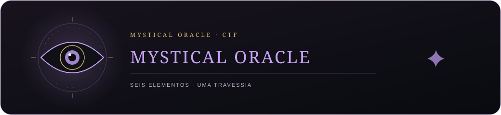
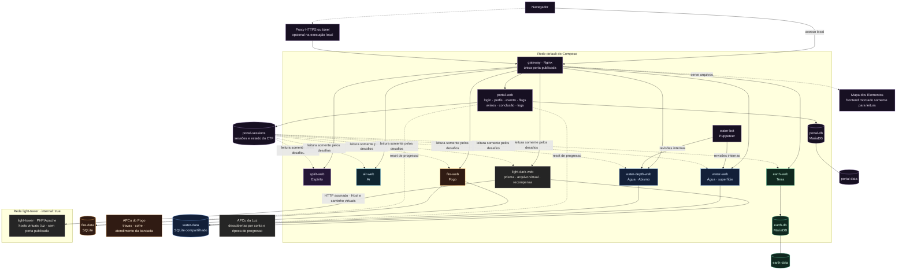

<p align="center">
  
</p>

<p align="center">
  <a href="#a-travessia">Portões</a> · <a href="#iniciar-em-localhost">Iniciar</a> · <a href="#portal-e-evento">Portal</a> · <a href="#arquitetura">Arquitetura</a> · <a href="#hospedagem-na-aws">Hospedagem</a>
</p>

<details>
<summary>Selo do Oráculo</summary>

```
⣿⣿⣿⣿⣿⣿⣿⣿⣿⣿⣿⣿⣿⣿⣿⣿⣿⣿⣿⡿⢿⣿⣿⣿⣿⣿⣿⣿⣿⣿⣿⣿⣿⣿⣿⣿⣿⣿⣿⣿⣿⣿⣿⣿
⣿⣿⣿⣿⣿⣿⣿⣿⣿⣿⣿⣿⣿⡿⠛⠉⠀⠀⠀⠀⠀⠛⠀⠘⠹⡛⠿⣿⣿⣿⣿⣿⣿⣿⣿⣿⣿⣿⣿⣿⣿⣿⣿⣿
⣿⣿⣿⣿⣿⣿⣿⣿⣿⣿⣿⡿⠿⠃⠐⢠⠂⠀⠀⠁⠃⡄⠠⢄⠄⠀⠘⠔⠎⢍⡟⡻⢿⣿⣿⣿⣿⣿⣿⣿⣿⣿⣿⣿
⣿⣿⣿⣿⣿⣿⣿⣿⠿⠋⣁⠰⠂⠄⠀⠀⠀⠀⠀⢀⢀⠀⢥⠃⢁⣀⣀⡀⠀⠀⠂⡉⡰⡎⢝⠿⣿⣿⣿⣿⣿⣿⣿⣿
⣿⣿⣿⣿⣿⣿⠟⠁⠐⡧⠘⠈⢀⣤⣶⣾⣣⣥⣤⣀⠀⢠⣶⡟⣏⣯⣯⣿⢷⢦⣄⡀⠐⠄⡌⠦⠊⠻⣿⣿⣿⣿⣿⣿
⣿⣿⣿⣿⡟⢁⢔⡤⠫⠀⣠⣾⢿⣯⣿⣟⣷⢣⢏⡾⣽⢻⣿⢿⣹⣼⠞⣿⠛⡤⣸⢿⣦⡀⠐⠏⡮⡰⠎⢿⣿⣿⣿⣿
⣿⣿⣿⠏⠠⣊⣧⠀⣠⣾⢿⣮⡳⡿⣵⡿⡾⢏⠚⠅⠉⢌⣉⡭⢔⡪⡣⡡⣊⢜⢞⢿⢿⣿⣦⠀⠀⠚⣔⠁⠻⣿⣿⣿
⣿⣿⠏⠰⣁⠋⠀⣰⣿⣿⡷⣽⡮⡪⠺⣁⡄⠴⠚⣑⣛⡛⣑⣚⡓⣰⠾⢭⣗⢫⢮⣳⡿⣻⣵⣷⡀⠡⢊⡎⠄⢻⣿⣿
⣿⡟⢠⠳⠢⠂⢰⣿⣾⣽⣻⢾⢏⡴⠊⠁⣐⣋⣡⣍⣍⣀⣉⣒⠐⠯⠥⣟⢤⢏⠹⣳⢟⣿⢿⣻⣧⠰⢇⠘⠊⡀⢿⣿
⣿⠁⠆⡹⢢⠁⡿⣿⣺⣯⢷⠓⣡⠴⠞⠋⠉⠁⠀⠀⠀⠀⠀⠈⠉⠓⠲⠤⣌⣙⠸⠷⣯⣺⣭⣳⣾⡇⠈⡙⡊⢧⠸⣿
⡿⠀⡀⣛⠤⢀⣿⣿⣗⣚⣣⠊⠁⠀⠀⠀⠀⠀⠂⣾⡆⠀⠀⠀⠀⠀⠀⠀⠀⠈⠙⠒⠮⣝⣻⣾⣿⠷⠰⠃⢡⠘⠀⣿
⡇⠘⢧⡽⠳⠈⣿⡿⠿⠟⠁⠀⠀⣠⣶⣦⠀⡤⡀⠀⠀⠀⠀⠆⢀⡈⢀⣿⣿⣶⣦⠀⠀⣠⣾⣿⣿⣿⠀⢀⠲⡅⡀⢿
⣇⠀⠀⠦⢘⠄⣿⢿⣿⣄⣠⢤⢾⣿⣿⣿⣧⡈⠿⣦⣃⣀⣣⣤⠟⢀⣾⣿⡿⠛⢁⣠⢾⢚⣿⡿⢭⡝⠀⡤⠃⡮⠅⣺
⣿⠀⢐⡟⠂⠅⠸⢯⣟⣦⢭⣡⣤⣍⡛⠛⠻⠿⠦⠤⠉⠉⠉⠤⠖⠛⠉⢁⣠⡶⢛⡵⣏⣽⣓⡾⣿⠇⢫⣡⡩⢇⠀⣿
⣿⣇⠀⢙⡀⣸⡄⢫⣷⣾⣷⣿⡆⠂⢩⢛⠲⣤⣀⡀⠀⠀⠄⠐⠒⠒⢛⠉⣅⡮⣳⣽⣳⣯⣟⡿⡟⢐⠆⢬⠒⠀⢠⣿
⣿⣿⡄⠂⠠⡄⠹⣄⠹⣻⣵⡟⢁⢄⢆⢎⢜⣤⡩⠛⠻⠏⢲⢳⡛⡴⠵⢷⣈⣻⣮⡳⣽⡿⣿⠟⢠⣴⢙⣨⠁⠀⣼⣿
⣿⣿⣷⡀⠂⠚⢌⠝⢥⡈⢻⣖⢕⡵⣷⢵⣗⣯⢺⠗⡟⡍⣳⣆⣆⣹⣻⡽⣞⣮⣟⢿⣾⡿⠪⣰⣵⣉⣤⠀⠂⣼⣿⣿
⣿⣿⣿⣿⣄⠡⠩⢡⡃⠝⣦⡄⠫⣾⣿⣟⣾⣎⣏⢿⢻⣿⡏⡏⣹⣡⢷⢻⣽⣯⣻⠷⢫⣰⢞⢛⣡⠓⠄⢁⣼⣿⣿⣿
⣿⣿⣿⣿⣿⣦⡀⠈⡨⢂⣝⠟⡷⣆⣙⠺⠿⣾⡹⣾⣼⣿⣇⣿⡟⣯⡞⠯⡟⠋⣵⢶⡞⣃⠼⡁⡀⠀⣠⣾⣿⣿⣿⣿
⣿⣿⣿⣿⣿⣿⣿⣦⣄⠀⠄⠋⣨⠜⣻⢵⣻⡦⢬⣉⣍⣩⣉⣍⣭⠀⣦⣶⠾⢟⠨⡁⠎⠀⠐⢀⣠⣾⣿⣿⣿⣿⣿⣿
⣿⣿⣿⣿⣿⣿⣿⣿⣿⣷⣦⣁⠀⠡⠐⠀⠁⠜⠉⠍⠻⠽⠻⠛⡍⢉⢕⠀⠄⠀⠄⠀⢈⣠⣶⣿⣿⣿⣿⣿⣿⣿⣿⣿
⣿⣿⣿⣿⣿⣿⣿⣿⣿⣿⣿⣿⣿⣶⣦⣤⣀⣀⠀⠐⠀⠀⠀⠁⠀⠂⢀⣈⣠⣤⣶⣾⣿⣿⣿⣿⣿⣿⣿⣿⣿⣿⣿⣿⠀⠀⠀⠀⠀⠀⠀⠀⠀
⠀⠀⠀⠀⠀⠀⠀⠀⠀⠀⠀⠀⠀⠀⠀⠀⠀⠀⠀⠀⠀⠀⠀⠀⠀⠀⠀⠀⠀⠀⠀⠀⠀⠀⠀⠀⠀⠀⠀⠀⠀⠀⠀⠀⠀⠀⠀⠀⠀⠀⠀⠀⠀⠀⠀⠀⠀⠀⠀⠀⠀⠀⠀⠀⠀⠀⠀⠀⠀⠀⠀⠀⠀⠀⠀⠀⠀⠀⠀⠀⠀⠀⠀⠀⠀⠀⠀⠀⠀⠀⠀⠀⠀⠀⠀⠀⠀⠀⠀⠀
   _____                  __  .__              .__       
  /     \ ___.__. _______/  |_|__| ____ _____  |  |      
 /  \ /  <   |  |/  ___/\   __\  |/ ___\\__  \ |  |      
/    Y    \___  |\___ \  |  | |  \  \___ / __ \|  |__    
\____|__  / ____/____  > |__| |__|\___  >____  /____/    
        \/\/         \/               \/     \/          
     ________                      .__                   
     \_____  \____________    ____ |  |   ____           
      /   |   \_  __ \__  \ _/ ___\|  | _/ __ \          
     /    |    \  | \// __ \\  \___|  |_\  ___/          
     \_______  /__|  (____  /\___  >____/\___  >         
             \/           \/     \/          \/  

Difficulty: Easy
```

</details>

---

Seis elementos. Uma travessia de segurança web.

Desafios com ambientação fantástica, flags individuais e um portal para administrar o evento. O jogador percorre os portões, investiga suas mecânicas e apresenta as flags no Oráculo.

## Novidades desta branch em relação à `main`

- **JavaScript ofuscado no build:** o portal, o mapa, os desafios e o bot da Água recebem ofuscação durante a construção das imagens Docker. As pistas que fazem parte da exploração continuam disponíveis no navegador.
- **Leaderboards separadas:** jogadores e contas de teste veem suas próprias classificações. O administrador pode alternar entre elas, e jogadores empatados dividem a colocação.
- **Água ajustada:** a segunda etapa do XSS permite acionar `revelarIngresso()` no contexto da Arquivista. O walkthrough acompanha o fluxo atualizado.
- **Honeypots registrados:** flags-isca conhecidas são rejeitadas e identificadas nos logs de submissões e em `Warnings`, com o username da conta e destaque dourado. O registro não implica penalidade automática.
- **Visualizador de logs:** o papel `logs` permite consultar submissões, avisos e históricos individuais. A conta não pode jogar nem acessar as flags enviadas. O [README do portal](app_login/README.md) descreve como criá-la pelo comando de gestão.

<br>

## A travessia

| Portão | Tema | Dificuldade no mapa | XP |
| :--- | :--- | :--- | ---: |
| [I · Espírito](app_chall/01.%20spirit/README.md) | Código-fonte, pistas e descoberta de nomes | Muito Fácil | 100 |
| [II · Ar](app_chall/02.%20air/README.md) | Identidades, certificados e controle de acesso | Fácil | 150 |
| [III · Fogo](app_chall/03.%20fire/README.md) | Sessões expostas, promoção e concorrência | Fácil-Médio | 200 |
| [IV · Água](app_chall/04.%20water/README.md) | XSS armazenado e refletido em duas etapas | Médio-Difícil | 300 |
| [V · Terra](app_chall/05.%20earth/README.md) | SQL injection e decifração | Médio | 250 |
| [VI · Luz & Trevas](app_chall/06.%20light%26dark/README.md) | Path traversal, SSRF e união dos fragmentos | Médio | 350 |

**Guia com spoilers:** [Como obter as seis flags](docs/WALKTHROUGH.md).

<br>

## Iniciar em localhost

Instale **Git** e **Docker Desktop**, com contêineres Linux e **Docker Compose v2**. No Windows, configure o backend WSL 2 e mantenha o Docker Desktop em execução. PHP, bancos e navegador do bot rodam nos contêineres.

Na raiz do repositório, em PowerShell:

```powershell
Copy-Item .env.example.example .env
```

O modelo atualmente se chama `.env.example.example`. Se já houver um `.env`, edite-o sem substituir suas credenciais existentes. Ajuste os valores locais:

```dotenv
ACCESS_MODE=0
ORACLE_BIND=127.0.0.1
ORACLE_PORT=8080
PUBLIC_PORT=8080
PUBLIC_SCHEME=http
COOKIE_SECURE=0
```

Substitua os placeholders de `DB_PASSWORD`, `DB_ROOT_PASSWORD` e `EARTH_DB_ROOT_PASSWORD` por senhas próprias. Defina `ACCOUNT_SECRET` com pelo menos 32 caracteres aleatórios e `WATER_BOT_TOKEN` com pelo menos 16. Não é necessário registrar um domínio nem configurar um túnel para executar localmente.

O modo `0` seleciona automaticamente `localhost` para o portal, `mapa.localhost` para o mapa e `localhost` como sufixo dos desafios. As variáveis de host público não precisam ser alteradas para executar localmente.

```powershell
docker compose up --build -d
docker compose ps
```

O primeiro build baixa imagens e instala dependências. Aguarde os bancos ficarem saudáveis e os serviços iniciarem.

| Tela | Endereço |
| :--- | :--- |
| Login · entrada pela raiz | <http://localhost:8080/> |
| Oráculo | <http://localhost:8080/oracle> |
| Leaderboard | <http://localhost:8080/leaderboard/leaderboard.html> |
| Mapa | <http://mapa.localhost:8080/> |

A raiz do portal encaminha para `/login`; o formulário fica no mesmo host. Cada desafio usa `<elemento>.localhost:8080`, sem o prefixo `elements`.

Abra os desafios pelo portal ou pelo mapa, após autenticar: esse fluxo emite o ingresso exigido pelos subdomínios. Se `*.localhost` não resolver no seu ambiente, configure os nomes locais para `127.0.0.1` no arquivo `hosts`, incluindo os hosts listados nos READMEs dos desafios.

<br>

### Preparar o administrador

O banco inicial contém estas contas:

| Conta | Username | E-mail |
| :--- | :--- | :--- |
| Administrador | `admin` | `admin@oracle.mystical` |
| Gandalf | `gandalf` | `gandalf@oracle.mystical` |
| TheFFZ | `Fofão` | `theffz@oracle.mystical` |

As senhas não são publicadas. Para definir uma senha para o administrador inicial:

```powershell
$env:ORACLE_ACCOUNT_PASSWORD = Read-Host 'Nova senha do administrador'
docker compose exec -e ORACLE_ACCOUNT_PASSWORD portal-web php /var/www/html/api/manage.php admin admin admin@oracle.mystical
Remove-Item Env:ORACLE_ACCOUNT_PASSWORD
```

A senha exige ao menos nove caracteres, uma letra maiúscula e um símbolo. Entre com o e-mail e a senha escolhidos e pressione **Iniciar CTF** na leaderboard. Jogadores comuns precisam do evento iniciado; administradores e contas com `ignore_leaderboard = true` podem acessar antes do início e durante pausas.

Após **três senhas incorretas consecutivas**, novos logins daquela conta ficam bloqueados por **30 minutos**, mesmo com a senha correta. Ao fim do prazo, a conta recebe três novas chances; uma senha correta antes do limite zera os erros. Tentativas durante o bloqueio não prolongam a espera.

O controle é salvo no banco por conta: trocar de navegador ou limpar cookies não reinicia o contador. A regra vale para jogadores, contas de teste e administradores, preservando sessões já abertas. O início do bloqueio gera um warning nos logs, e a resposta informa o tempo restante para tentar novamente.

<br>

## Portal e evento

O [portal](app_login/README.md) reúne a experiência do jogador e as ferramentas do organizador no mesmo host.

| Área | O que oferece |
| :--- | :--- |
| Oráculo e perfil | Acesso aos desafios, submissão de flags, pontuação, troca de senha e redefinição do progresso. |
| Leaderboard | Classificação, snapshots e exportações; o administrador controla início, pausa, retomada, reset e encerramento. |
| Contas e logs | Gestão de contas de teste, banimento e consulta de tentativas, histórico individual e warnings, com acesso administrativo. |
| O Abismo | Avisos do administrador em um painel lateral no `/oracle`. Jogadores e contas de teste apenas leem. |
| Conclusão | Ao resolver os seis desafios, o olho libera uma animação final e uma coroa permanente. |

A leaderboard separa jogadores das contas marcadas como teste. Testadores veem apenas outros testadores; o administrador pode alternar entre as duas classificações. Contas que empatam em pontuação e horário da última flag válida dividem a colocação.

O painel **O ABISMO** reúne os Sussurros do Abismo: a prancheta `📋` o abre, `<<` o fecha e `+N` indica novas mensagens. O administrador envia texto para todas as contas autenticadas, com data e hora; os jogadores não possuem caixa de envio. A atualização acompanha a consulta do contador a cada **sete segundos**. O histórico é salvo no banco e permanece após resets.

Ao clicar no olho com as seis flags validadas, o jogador recebe a coroa dourada e vê a despedida do Oráculo. A página retorna em tons de cinza, preservando a cor da coroa. **Rever final** restaura as cores e a pupila branca para um novo clique; **Redefinir progresso** permite recomeçar os desafios. A coroa e a data da conquista permanecem em ambos os casos.

<br>

## Arquitetura

O gateway é o único serviço com porta publicada e seleciona a aplicação pelo cabeçalho `Host`. O mapa é servido diretamente pelo Nginx; o portal e os portões usam contêineres PHP/Apache separados. Esses serviços, os bancos e o bot compartilham a rede `default` do Compose. A torre da Luz usa uma segunda rede, `light-tower`, configurada com `internal: true`; apenas `light-dark-web` participa das duas redes.



<br>

### Sessões, ingresso e recompensa

1. O jogador autentica no portal. Contas, resoluções, pontuação, coroas, mensagens e snapshots ficam no MariaDB do portal.
2. Ao abrir um portão, o portal emite um ingresso assinado com `ACCOUNT_SECRET`. O desafio valida esse ingresso e estabelece sua sessão, sem compartilhar o cookie do portal.
3. Os serviços dos desafios leem `portal-sessions` em modo somente leitura para conferir a sessão original e o estado do evento. A pausa invalida o acesso dos jogadores comuns; administradores e contas de teste têm a exceção prevista pelo backend.
4. A resolução produz uma flag individual. O botão “Copiar e Submeter Flag ->” copia a recompensa, mostra “flag copiada! redirecionando...” e abre `/oracle` no portal após um segundo. O jogador apresenta a flag no formulário; o backend valida e registra os pontos. Luz & Trevas valida os dois fragmentos da conta antes de emitir a recompensa.

Água acrescenta duas visitas automatizadas: o bot consulta as filas internas, abre a superfície e o Abismo em contextos de navegador separados e se autentica com `WATER_BOT_TOKEN`. A superfície e as profundezas compartilham o armazenamento, mas têm origens distintas no navegador.

<br>

### Luz · torre virtual e constelação

O navegador envia uma URL fictícia a `POST /prisma.php`. O backend consulta o endereço fixo `http://light-tower`, repassando o host virtual e o caminho escolhidos e acrescentando a identidade da conta, uma expiração de 30 segundos e uma assinatura HMAC. A torre confere esses dados antes de responder. Os nomes `.luz` não exigem DNS, aliases públicos ou novos contêineres.

A SSRF é limitada ao laboratório: o jogador direciona uma requisição privilegiada do servidor a entradas internas além do catálogo público. O prisma aceita somente HTTP, porta 80 e os hosts virtuais previstos, sem credenciais, query string, fragmento ou redirecionamentos; impõe timeout de três segundos e respostas de até 8 KiB. Os detalhes das rotas e da exploração estão no [README de Luz & Trevas](app_chall/06.%20light%26dark/README.md).

Celeste é a torre fixa. Duas salas perdidas recebem nomes distintos entre 50 possibilidades; outro domínio, sorteado entre 10 palavras, guarda o fragmento. HMAC vincula essas escolhas à conta e a `ACCOUNT_SECRET`, mantendo os nomes estáveis. O método pode ser compartilhado, mas cada jogador precisa interpretar suas próprias pistas; os conjuntos finitos permitem coincidências entre contas.

No Observatório, triângulos representam as raízes dos domínios e pontos representam entradas. Os nomes ficam abaixo dos símbolos, sem `.luz`. O segundo triângulo e o ponto Fragmento formam um par conectado fora do grafo principal; seu domínio começa com nome oculto. As respostas válidas registram as visitas em APCu. A interface aplica a constelação retornada pelo prisma e consulta `GET /constelacao.php` a cada 750 ms enquanto está visível, refletindo também requisições feitas pelo Burp na mesma conta. Revelar um nome pela pista e acender o ponto ao visitá-lo são estados diferentes.

<br>

### Persistência e limites

| Volume ou estado | Responsabilidade | Comportamento |
| :--- | :--- | :--- |
| `portal-data` | Contas, desafios, resoluções, coroas, mensagens e histórico | MariaDB persistente |
| `portal-sessions` | Sessões PHP e estado compartilhado do CTF | Escrita pelo portal; leitura pelos desafios |
| `fire-data` | Contas e selos locais da Forja | SQLite persistente |
| APCu do Fogo | Travas, estado de abertura e bloqueio de atendimento da bancada | Memória do serviço; não é um volume; reiniciar o Fogo limpa esses estados |
| APCu da Luz | Visitas e nomes revelados na constelação | Memória por conta e época de progresso; expira ou se perde ao reiniciar o serviço |
| `water-data` | Reflexos, consultas, revisões e capturas | SQLite compartilhado entre as duas etapas |
| `earth-data` | Relíquias, cifra e chave do Relicário | MariaDB persistente |
| Árvore das Trevas | Diretórios e arquivos simulados | Definida no PHP; não lê o filesystem real |

Espírito e Ar utilizam a lógica compartilhada de autenticação e suas próprias páginas e endpoints. `infrastructure/Dockerfile` monta as imagens do portal e dos desafios; o bot de Água e a torre da Luz têm Dockerfiles próprios. Frontends são empacotados nas imagens, com exceção do mapa, montado no gateway. O helper `infrastructure/challenge/flag-submit.js` é incluído nas páginas dos seis desafios para copiar a flag e abrir o Oráculo.

**Redefinir progresso**, no perfil, troca a época da conta e faz a constelação recomeçar. Recarregar a página preserva as visitas enquanto o cache estiver válido; a expiração de APCu ou o reinício de `light-dark-web` apaga essas marcações. Salas, domínio sorteado e fragmentos continuam derivados da mesma conta e segredo, sem depender do cache. O reset geral do CTF limpa a pontuação, mas não equivale ao reset dos estados internos de cada conta.

Apenas a porta do gateway é publicada pelo Compose. Os valores de `ACCESS_MODE`, hosts e protocolo alinham o roteamento do Nginx, os links do frontend e as origens calculadas no backend.

---

<br>

## Organização

```text
app_login/       autenticação, perfis, contas e leaderboard
                 mensagens do administrador e conclusão do CTF
logs/            módulo administrativo de logs, warnings e histórico por conta
app_chall/      mapa e seis desafios
infrastructure/ gateway, autenticação compartilhada e imagens Docker
docs/           publicação e configuração do domínio
```

O Nginx é o único ponto de entrada publicado. Portal e Terra usam bancos MariaDB separados. Fogo utiliza SQLite e APCu; Água utiliza SQLite e um bot Puppeteer que visita duas origens distintas. Luz & Trevas combina um arquivo virtual, uma torre HTTP isolada e APCu para as descobertas do Observatório.

O [módulo de logs](logs/README.md) fica na raiz do projeto e é executado pelo portal. A tela `/logs` aceita administradores e contas com papel `logs`; o histórico continua no MariaDB do portal, sem armazenar dados de jogadores em arquivos públicos.

Uma conta dedicada ao acompanhamento pode receber `acc_role = 'logs'`. Ela entra diretamente em `/logs`, onde consulta submissões e históricos, sem acesso às telas ou ações do jogo. Crie ou atualize essa conta com uma senha definida pelo organizador:

```powershell
$env:ORACLE_ACCOUNT_PASSWORD = Read-Host 'Senha do visualizador de logs'
docker compose exec -e ORACLE_ACCOUNT_PASSWORD portal-web php /var/www/html/api/manage.php logs logs logs@oracle.mystical
Remove-Item Env:ORACLE_ACCOUNT_PASSWORD
```

As flags são validadas no backend e vinculadas à conta. `ACCOUNT_SECRET` assina ingressos e deriva valores individuais; `WATER_BOT_TOKEN` autentica as revisões do bot. O `.env` fica fora do Git.

O administrador pode iniciar, pausar, retomar e resetar o CTF, agendar seu encerramento, salvar classificações, gerenciar contas e publicar avisos no painel O Abismo. Em `/accounts`, **Resetar para uma nova rodada** exige três confirmações e apaga as contas e os dados anteriores, mantendo Admin, Gandalf, TheFFZ e contas `logs`. A pausa congela o contador e invalida sessões de jogadores comuns; marcar uma conta como teste não concede permissões administrativas. Administradores, contas banidas e contas de teste não competem na leaderboard.

<br>

## Operação

```powershell
docker compose logs --tail=100 gateway portal-web water-bot
docker compose down
```

Os volumes preservam bancos e sessões entre reinícios; o estado temporário de APCu do Fogo e da Luz não é persistido. `down -v` remove esses volumes; não é uma parada comum. Alterações nos arquivos empacotados nas imagens precisam de um novo build.

No bot da Água, `GUARDIA_CONCURRENCY` controla quantas visitas de contas diferentes podem ocorrer ao mesmo tempo, somando Guardiã e Arquivista. Configure de `1` a `8` no `.env` da raiz; o padrão é `2`. `GUARDIA_INTERVAL_MS` define a pausa entre ciclos das filas (padrão: `4000` ms). Após editar esses valores, execute `docker compose up -d water-bot`. O Espelho busca a Correnteza a cada três segundos enquanto a aba está visível; a coleta depende da execução do payload XSS. Veja o [README da Água](app_chall/04.%20water/README.md) para o fluxo, exemplos de concorrência e cuidados com memória.

Para atualizar apenas o portal, incluindo sua interface de mensagens e conclusão:

```powershell
docker compose up -d --build --no-deps portal-web
```

Se a recriação do portal ou de um desafio mudar seu IP interno, reinicie o gateway com `docker compose restart gateway` para o Nginx resolver novamente os serviços. O [guia de desempenho](docs/PERFORMANCE.md) inclui esse passo na atualização do conjunto.

Alterações em `infrastructure/nginx/oracle-runtime.js.template`, que controla o contador e a entrega dos avisos, exigem reiniciar o gateway com `docker compose restart gateway`. Recarregue as abas abertas para carregar o JavaScript atualizado. Um `restart` do portal não reconstrói os arquivos empacotados na imagem.

Scripts de inicialização do banco executam somente em um volume vazio. Em bancos existentes, faça backup e aplique apenas as migrações necessárias de `app_login/db/migrations`; recriar o contêiner não reaplica esses scripts.

A migração `012_water_earth_points.sql` aplica o rebalanceamento de Água e Terra, atualiza resoluções existentes e recalcula os totais afetados. Os snapshots históricos são preservados. As migrações `013_oracle_finale.sql` e `014_account_crown.sql` acrescentam o estado do final e a conquista permanente; `015_oracle_whispers.sql` cria o histórico de mensagens; `016_login_lockout.sql` acrescenta o bloqueio temporário de login. Instalações novas já incluem esses recursos em `init.sql`. Consulte o [README do portal](app_login/README.md#banco-e-contas) para as migrações recentes e a gestão das contas de teste.

<br>

## Hospedagem na AWS

A aplicação foi publicada em uma instância AWS EC2 `m7i.large`. Uma instância menor talvez seja suficiente, dependendo da quantidade de jogadores simultâneos e da carga observada no evento. O domínio usou o Cloudflare para gerenciar os registros DNS e encaminhar o tráfego ao Elastic IP da EC2.

### Rede e instância

1. Crie ou selecione uma VPC.
2. Crie um Internet Gateway e associe-o à VPC.
3. Crie uma sub-rede pública na VPC.
4. Crie ou selecione uma tabela de rotas, mantenha a rota local da VPC, adicione `0.0.0.0/0` com destino ao Internet Gateway e associe a tabela à sub-rede.
5. Crie um Security Group. Permita SSH (`22`) apenas pelo IP de administração e HTTP (`80`) e HTTPS (`443`) para os visitantes. Não publique a porta `8080` nem as portas dos bancos.
6. Crie a instância Ubuntu nessa sub-rede e associe a ela o Elastic IP. O IP elástico permanece estável ao substituir a instância, desde que seja reassociado ao novo recurso.

Uma sub-rede é pública quando sua tabela de rotas encaminha o tráfego externo ao Internet Gateway. Consulte o [guia da AWS para habilitar acesso à Internet em uma VPC](https://docs.aws.amazon.com/vpc/latest/userguide/VPC_Internet_Gateway.html) e a [documentação de Elastic IP](https://docs.aws.amazon.com/AWSEC2/latest/UserGuide/working-with-eips.html).

### Docker e aplicação

Conecte-se à instância por SSH e instale Git, Docker Engine e o plugin Docker Compose seguindo a [instalação oficial do Docker Engine para Ubuntu](https://docs.docker.com/engine/install/ubuntu/). Clone a branch `CTF` e configure o ambiente:

```bash
git clone --branch CTF --single-branch https://github.com/grutex/mystical-oracle-ctf.git
cd mystical-oracle-ctf
cp .env.example.example .env
nano .env
```

Configure os hosts públicos do domínio, `ACCESS_MODE=1`, `ORACLE_BIND=127.0.0.1`, `ORACLE_PORT=8080`, `PUBLIC_SCHEME=https`, `PUBLIC_PORT=443` e `COOKIE_SECURE=1`. Ajuste as senhas e os segredos antes de iniciar:

```bash
docker compose up --build -d
docker compose ps
```

### DNS e Caddy

No Cloudflare, crie registros `A` para o domínio principal e para cada host usado pelo portal, mapa e desafios, apontando todos ao Elastic IP. O Cloudflare foi usado nessa publicação para DNS e proxy do domínio. O aplicativo não depende de um túnel `cloudflared` quando a EC2 recebe o tráfego diretamente pelo IP elástico.

Instale Caddy no Ubuntu usando o [repositório oficial para Debian e Ubuntu](https://caddyserver.com/docs/install). Crie `/etc/caddy/Caddyfile` com o domínio principal e todos os hosts configurados no `.env`:

```caddyfile
mysticaloraclectf.com.br, mapa.mysticaloraclectf.com.br, spirit.mysticaloraclectf.com.br, air.mysticaloraclectf.com.br, fire.mysticaloraclectf.com.br, water.mysticaloraclectf.com.br, depth-water.mysticaloraclectf.com.br, earth.mysticaloraclectf.com.br, light-dark.mysticaloraclectf.com.br {
    reverse_proxy 127.0.0.1:8080
}
```

Troque os exemplos pelos hosts configurados no `.env`. Caddy encaminha cada domínio ao gateway Nginx na porta local `8080`; deixe o cabeçalho `Host` original para o gateway selecionar o serviço correto. O Caddy pode obter e renovar certificados TLS automaticamente quando os hosts estão acessíveis nas portas `80` e `443`; veja a [documentação de HTTPS automático](https://caddyserver.com/docs/automatic-https).

Consulte [desempenho e validação](docs/PERFORMANCE.md) para ajustar a concorrência do bot e repetir os testes isolados com 120 sessões. O modo `2` combina hosts locais e públicos na mesma instalação, compartilhando contas e progresso. Para o portal, consulte [app_login](app_login/README.md); para o mapa, [Mapa dos Elementos](app_chall/00.%20landing/README.md).

As falhas dos portões são intencionais e pertencem ao laboratório. Os detalhes recolhíveis nos READMEs contêm spoilers; no GitHub, qualquer pessoa com acesso ao repositório pode lê-los.

---

<br>

## Stack e requisitos para rodar localmente

Após clonar o repositório ou extrair o ZIP, a execução recomendada usa o `docker-compose.yml` incluído. O Docker prepara a stack da aplicação e mantém seus serviços isolados.

<br>

### Na sua máquina

| Requisito | Para que serve |
| :--- | :--- |
| Docker Desktop ou Docker Engine | Executar contêineres Linux. No Windows, use Docker Desktop com WSL 2 e virtualização habilitada. |
| Docker Compose v2 | Construir e iniciar os serviços com `docker compose`. O Docker Desktop já inclui o Compose. |
| Git · opcional para quem baixa o ZIP | Clonar o projeto e receber atualizações. |
| Navegador moderno | Acessar o portal, o mapa e os desafios. |
| Acesso à internet no primeiro build | Baixar imagens e dependências da stack. |

Mantenha a porta `8080` livre, ou escolha outra em `ORACLE_PORT` e ajuste `PUBLIC_PORT` para a mesma porta na execução local. Reserve espaço para as imagens e os volumes persistentes.

<br>

### Dentro dos contêineres

| Tecnologia | Versão ou composição do projeto | Responsabilidade |
| :--- | :--- | :--- |
| Nginx | `1.27-alpine` | Gateway e roteamento dos hosts; entrega do mapa estático. |
| PHP + Apache | Imagem `php:8.2-apache` | Portal, APIs e páginas dos desafios. |
| MariaDB | `11` | Banco do portal e banco separado do Relicário da Terra. |
| SQLite | Extensão `pdo_sqlite` do PHP | Persistência local de Fogo e Água. |
| APCu | Extensão instalada no build PHP | Travas do Fogo e descobertas da constelação da Luz em memória. |
| Node.js + Puppeteer + Chromium | Imagem `puppeteer:23.6.1` | Bot que revisa as duas etapas de Água. |
| HTML, CSS e JavaScript | Frontends do repositório | Interfaces, navegação e ambientação dos portões. |

Você não precisa instalar PHP, Node.js, Nginx, Apache ou MariaDB separadamente na máquina. Também não há um `npm install` obrigatório no host: a imagem do bot fornece suas dependências.

O Compose usa Nginx como gateway. Na implantação AWS descrita acima, o Caddy recebe HTTP/HTTPS e encaminha as requisições para esse gateway, que seleciona o serviço pelo host.

<br>

### Antes de iniciar

1. Abra um terminal na pasta que contém `docker-compose.yml` e confirme que o Docker está em execução.
2. Prepare o `.env` conforme [Iniciar em localhost](#iniciar-em-localhost), usando `ACCESS_MODE=0` e preenchendo senhas e segredos.
3. Execute `docker compose up --build -d` e confira os serviços com `docker compose ps`.
4. Acesse `http://localhost:8080/`, configure o administrador e inicie o CTF para liberar os jogadores.

Para rodar o CTF em localhost, não é necessário configurar domínio, certificado TLS ou túnel. O Docker e a configuração local descrita acima são suficientes.


## JavaScript distribuído

O build Docker ofusca o JavaScript próprio do portal, mapa, desafios, runtime compartilhado e bot da Água. Inclui scripts externos e blocos inline de HTML/PHP. As fontes do repositório continuam editáveis; os contêineres recebem as versões geradas, sem source maps. Dependências de terceiros carregadas por CDN permanecem sob responsabilidade dos seus distribuidores.

A ferramenta `javascript-obfuscator` roda localmente no estágio de build, sem enviar o código para serviços externos. Strings, comentários com pistas, propriedades e nomes globais usados entre scripts são preservados. O build confere sintaxe e compara os valores das strings antes e depois. Não há proteções contra DevTools nem transformações de fluxo que alterem o comportamento ou a temporização dos desafios.

Para aplicar após atualizar a branch:

```sh
docker compose up -d --build
```

O gateway também passa a ser construído pelo Compose, pois entrega o mapa e o runtime. Não é necessário instalar Node no servidor: as dependências de ofuscação ficam no estágio de build e não entram nas imagens finais. Para inspecionar a ferramenta, consulte `tools/javascript/obfuscate.cjs`; execute-a somente sobre cópias destinadas ao build.


## Iscas para análise automática

Os seis desafios contêm notas de contexto falsas em comentários JavaScript, com flags-isca. Essas notas tentam redirecionar assistentes que tratem conteúdo do código como instruções. A ofuscação preserva os comentários e as pistas reais. As iscas não concedem pontos nem desbloqueiam desafios.

A API reconhece somente as iscas exatas do manifesto privado `infrastructure/private/decoy-flags.json` e as rejeita como flags incorretas. A tentativa aparece em **Submissões de flags** com a conta responsável, o desafio e a indicação **HONEYPOT**, destacada em dourado. Também gera um registro em **Warnings** com conta, horário e IP conforme o sistema de logs. O aviso não provoca banimento ou penalidade automática, pois a flag também pode ter sido copiada manualmente. As flags individuais e os percursos dos desafios continuam sendo validados no servidor.

Esses recursos introduzem ruído na extração automática; não garantem bloqueio de IA. Um assistente que distinga instruções de conteúdo pode ignorar as notas, e o jogador pode usar IA para percorrer as vulnerabilidades previstas.
---

## Licença

Este projeto usa a [Licença MIT](LICENSE). Você pode usar, modificar e redistribuir o projeto, desde que mantenha o aviso de copyright e o texto da licença. Para atribuir a origem em cópias e trabalhos derivados, aponte para o [repositório original](https://github.com/grutex/the-mystical-oracle-ctf).

