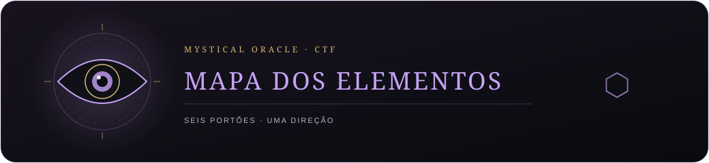

  

# Mapa dos Elementos

*Seis portões, uma direção.*

O mapa apresenta a progressão, a identidade visual dos elementos e sua pontuação. É uma tela de navegação, sem flag própria.

## Portões e pontuação

| Portão | Dificuldade exibida | XP |
| :--- | :--- | ---: |
| [Espírito](../01.%20spirit/README.md) | Muito Fácil | 100 |
| [Ar](../02.%20air/README.md) | Fácil | 150 |
| [Fogo](../03.%20fire/README.md) | Fácil-Médio | 200 |
| [Água](../04.%20water/README.md) | Médio-Difícil | 300 |
| [Terra](../05.%20earth/README.md) | Médio | 250 |
| [Luz & Trevas](../06.%20light%26dark/README.md) | Médio | 350 |

Os seis desafios somam **1.350 XP**. Luz & Trevas está implementado, com dificuldade e pontuação definidas; não há indicação `TBD`.

Este mapa organiza os seis portões. A constelação com triângulos, faróis perdidos e atualização das visitas fica dentro do Observatório de Luz & Trevas; suas regras estão no README daquele desafio.

## Navegação e entrega

`frontend/oracle_chall_landing.html`, `.css` e `.js` compõem a interface. O gateway serve esses arquivos diretamente; a configuração de runtime fornece os hosts usados pelos links.

Os links dos portões passam por `/api/api.php?action=launch&challenge=<chave>` no portal, que emite o ingresso e encaminha ao subdomínio correto. O link do Oráculo retorna a `/oracle`. Ao obter uma flag em qualquer desafio, **Copiar e Submeter Flag ->** copia a recompensa e retorna ao portal para submissão manual.

**Voltar ao Oráculo** preserva a sessão do portal. O painel de avisos **O ABISMO** (Sussurros do Abismo), o perfil e a animação de conclusão ficam no `/oracle`; não são telas do mapa. Consulte o [README do portal](../../app_login/README.md) para esses recursos e suas permissões.

Com a configuração local do [README principal](../../README.md), abra <http://mapa.localhost:8080/>. Em domínio, o host é definido por `MAP_HOST`, por exemplo `mapa.seu-dominio.tld`. Para entrar nos desafios, o jogador precisa se autenticar no portal e obter o ingresso correspondente.

Consulte o [README principal](../../README.md) para iniciar a aplicação e os READMEs dos portões para conhecer suas mecânicas.

---

[← Voltar ao Oráculo](../../README.md)
