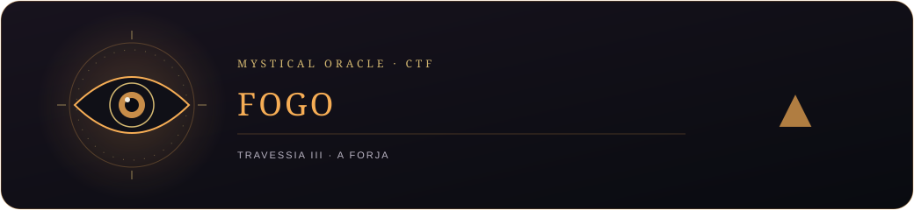

  

# III · Fogo

*A Forja exige autoridade. O Cofre exige simultaneidade.*

**200 XP** · Sessões, escalonamento e concorrência · Implementado

O jogador forja um selo local, encontra uma sessão privilegiada e tenta abrir quatro travas no mesmo intervalo. O portão usa tons de brasa e mantém a identidade recebida do portal.

## Mecânica

A Forja recebe o username imutável do ingresso assinado. O jogador cadastra apenas sua senha local, armazenada com hash em SQLite; não escolhe uma segunda identidade.

Uma listagem expõe sessões simuladas e uma sessão do Guardião Supremo. Assumi-la permite promover a própria conta dentro do desafio. A abertura do Cofre exige requisições concorrentes às quatro travas.

Essa promoção pertence à Forja: não transforma o jogador em administrador do portal.

### Bancada do aprendiz

O painel do jogador permite emitir uma requisição de carvão, imprimir um comprovante de turno, calcular uma liga de bronze (90% cobre e 10% estanho) e conferir o selo de entrada. Cada atendimento aceita uma operação; depois, os quatro comandos ficam bloqueados até **Refazer sessão**. Os registros podem ser baixados em TXT ou impressos. A bancada não modifica materiais reais, contas, flags nem travas do Cofre.

O bloqueio é validado no servidor e persiste ao recarregar. **Refazer sessão** reabre apenas o atendimento da bancada por um `POST /sessions`: a resposta devolve o token `sessions` atual, sem gerar outro token, trocar o cookie ou mudar a identidade e as permissões. O bloqueio da bancada também é limpo ao sair da Forja.

### Painéis de autoridade

O painel do Guardião lista todas as contas cadastradas na Forja, mas permite autorizar apenas a identidade vinculada ao jogador. A lista é somente de consulta para as demais contas. Os painéis de autoridade também incluem operações simuladas de ventilação, reposição de carvão, inspeção de runas e vigília, com um diário temporário das últimas ações. Esses controles não afetam as travas nem o progresso.

O controle **Aumentar potência da Forja** intensifica o brilho e acelera as animações de fundo. O ajuste permanece ao recarregar ou navegar na mesma aba enquanto a sessão da Forja estiver ativa; ao sair da Forja, o efeito retorna ao padrão.

Ao receber a flag, **Copiar e Submeter Flag ->** copia o valor, mostra **flag copiada! redirecionando...** e abre `/oracle` no portal após um segundo. O jogador cola e envia a flag no formulário para registrar os 200 XP.

## Estrutura

- `frontend/forja.*`: selo, sessão e interface do Cofre.
- `backend/lib.php`: contas, tokens, papéis e derivação da flag.
- `backend/sessions.php` e `promote.php`: listagem e promoção.
- `backend/workshop.php`: operações da bancada e limite de atendimento em APCu, separado do estado do Cofre.
- `backend/lock.php` e `vault.php`: travas e estado compartilhado em APCu.
- `tests/test.sh`: roteiro de verificação.
- `tests/workshop.php`: teste isolado das operações, bloqueio, renovação e preservação do estado do desafio. Com `fire-web` atualizado, copie o arquivo com `docker compose cp "app_chall/03. fire/tests/workshop.php" fire-web:/tmp/fire-workshop-test.php` e execute `docker compose exec -T fire-web php /tmp/fire-workshop-test.php`.
- `tests/workshop.cjs`: verificação da interface em desktop e celular com Node.js e Playwright (dependências opcionais de desenvolvimento), usando respostas controladas. Execute `node "app_chall/03. fire/tests/workshop.cjs"`; `PLAYWRIGHT_CHROMIUM_EXECUTABLE` permite informar um navegador existente e `ORACLE_TEST_ARTIFACTS` define onde salvar as capturas.

Host local: `fire.localhost:8080`, com a configuração do [README principal](../../README.md). Em domínio: `fire.<CHALLENGE_HOST>`. SQLite persiste no volume `fire-data`; as travas, o estado de resolução e o bloqueio de atendimento da bancada ficam em APCu e se perdem ao reiniciar o serviço.

Detalhes do percurso · spoilers

Após cadastrar o selo e entrar, use uma operação da bancada e observe a requisição de **Refazer sessão** na aba de rede. Ela revela a rota `/sessions` e devolve o token atual. Consultar a mesma rota por GET mostra 200 entradas: 98 sessões falsas e a sessão do jogador antes da sessão do Guardião Supremo, seguidas de mais 100 sessões falsas. As falsas têm tamanhos variados entre 60 e 100 bytes; a sessão privilegiada continua sendo a única maior, entre 200 e 250 bytes.

Substitua o cookie `sessions` pelo token do Guardião e use a promoção, limitada à conta daquela instância. Depois, acione as travas 1 a 4 em paralelo.

Cada trava tem latência artificial de **350 ms**; os registros precisam coincidir em uma janela de **300 ms**. Esperar uma resposta antes de enviar a próxima impede o fluxo pretendido. O Cofre devolve uma flag HMAC baseada no username do portal.

---

[← Voltar ao Oráculo](../../README.md)
