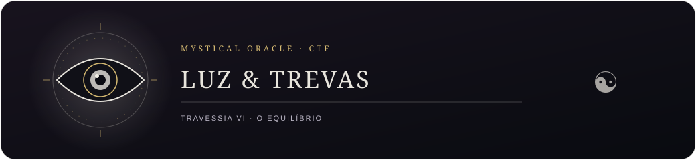

<p align="center">
  
</p>

# VI · Luz & Trevas

*O equilíbrio exige duas metades.*

**350 XP** · Médio no mapa · Path traversal e SSRF · Implementado

O Arquivo Luminar divide a chave entre dois caminhos. Trevas permite explorar um arquivo virtual; Luz usa o prisma do Observatório da Aurora para consultar uma torre HTTP interna e descobrir faróis perdidos. A apresentação usa cinza, branco suave e preto, com um símbolo giratório e uma aura alternada.

## Mecânica

### Trevas · Arquivo das Sombras

A primeira tela lista nomes do setor inicial. O leitor consulta um arquivo por vez e mostra o resultado em outra tela. A resolução dos caminhos e os conteúdos ficam no backend.

O servidor normaliza o caminho, mas não exige que ele permaneça no setor inicial. Isso permite subir pelos diretórios e encontrar um fragmento privado. A árvore inclui registros da Ordem e diretórios que simulam um sistema Linux.

São dados virtuais definidos no PHP. O leitor não executa `cat` nem acessa arquivos reais do sistema operacional.

### Luz · Observatório da Aurora

O jogador consulta Aurora, Zênite e Crepúsculo, entradas de `celeste.luz`. O navegador envia o destino a `POST /prisma.php`; o servidor consulta a torre por HTTP e devolve a transmissão. Zênite menciona o manifesto e indica um farol perdido com os campos `farol` e `seal` separados, sem entregar uma URL pronta.

Alterar a URL enviada ao prisma permite alcançar salas internas além dos três faróis catalogados. As duas salas recebem nomes distintos entre **50 possibilidades**, derivados por HMAC do ID da conta e de `ACCOUNT_SECRET`. São nomes de caminhos dentro de Celeste, sem `.luz` nas pistas. Recarregar, entrar novamente ou redefinir o progresso não muda o sorteio para a mesma conta e segredo.

As entradas das salas também respondem sem o último segmento, com ou sem barra final. Cada uma traz uma mensagem divertida e uma dica muito sutil: a lâmpada que exige tudo por escrito e o vigia que coleciona cera. Essas visitas acendem os pontos, mas não entregam o conteúdo do manifesto ou dos selos.

O manifesto e os selos guardam duas metades do nome de outro domínio, sorteado entre **10 palavras**. Nos selos, a entrada aparece como `seal: "REDACTED"`; a indicação foi transferida para a raiz desse domínio. A raiz de Celeste também responde, com uma mensagem sobre postes e magos. O percurso detalhado e exemplos das transmissões estão na seção de spoilers abaixo.

### Constelação e atualização do mapa

Os **triângulos representam raízes de domínios** e os **pontos representam entradas**: Celeste corresponde a `celeste.luz/`, enquanto Zênite corresponde a `/zenite` nessa torre. Todos os nomes ficam abaixo dos símbolos, sem o sufixo `.luz`. As pistas revelam nomes; uma resposta bem-sucedida à visita acende o ponto correspondente.

O segundo triângulo começa com nome oculto. Ele e o ponto do fragmento permanecem visíveis e apagados fora do grafo principal, unidos por uma linha. Visitar a raiz correta revela o nome sorteado do triângulo e o rótulo Fragmento; o ponto só acende quando a consulta entrega o fragmento. Consultar diretamente a entrada final correta também registra essa descoberta, sem exigir visitas anteriores.

`POST /prisma.php` retorna `source`, `transmission` e `constellation`, registrando descobertas apenas nas respostas HTTP 200 da torre. `GET /constelacao.php` fornece `domains` e `nodes` da conta autenticada, sem revelar nomes ainda desconhecidos. A página consulta esse endpoint a cada **750 ms** enquanto está visível e aplica imediatamente o resultado de suas próprias consultas; assim, requisições do Burp Repeater com a sessão da mesma conta também atualizam o mapa.

O estado fica em APCu, separado por conta e época de progresso. Recarregar preserva as visitas enquanto o cache estiver válido. **Redefinir progresso**, no perfil, reinicia as descobertas; resetar apenas o CTF no painel administrativo limpa a pontuação sem apagar esses estados internos. Reiniciar `light-dark-web` ou expirar o cache exige visitar novamente os pontos, mas não altera os nomes sorteados nem os fragmentos.

O método de exploração pode ser compartilhado. A torre, porém, confere os nomes atribuídos à conta: outra sala ou outro domínio final retorna 404. Os conjuntos finitos permitem coincidências entre jogadores; os fragmentos e a flag continuam individuais.

### Limiar · Recompensa

O formulário do portão recebe os fragmentos `UMBRA-...` e `LUMEN-...`. `POST /reward.php` verifica que ambos pertencem à conta autenticada e emite a flag individual aceita pelo portal, valendo 350 XP. Cada caminho sozinho é insuficiente.

O botão **Copiar e Submeter Flag ->** copia a flag, mostra **flag copiada! redirecionando...** e abre `/oracle` no portal após um segundo. O jogador cola e submete a flag no formulário do Oráculo, como nos outros cinco desafios.

## Estrutura

- `frontend/oracle_light_dark.*`: portão e caminhos.
- `frontend/arquivo_sombras.*`: listagem inicial e entrada do leitor.
- `frontend/leitor_sombras.*`: tela de leitura.
- `backend/diretorio.php`: nomes disponíveis na sala inicial.
- `backend/shadow.php`: árvore virtual, resolução e fragmento individual.
- `frontend/observatorio.*`: prisma, transmissões e constelação.
- `frontend/equilibrio.js`: envio manual dos dois fragmentos e cópia da flag.
- `backend/prisma.php`: consulta HTTP com destino controlado pelo jogador.
- `backend/constelacao.php`: estado autenticado dos domínios e pontos para sincronização do mapa.
- `internal/`: torre PHP/Apache com hosts virtuais e Dockerfile próprio, sem porta pública.
- `infrastructure/private/light-dark.php`, na raiz: sorteios, fragmentos, assinatura HTTP e descobertas em APCu.
- `infrastructure/challenge/flag-submit.js`, na raiz: cópia da flag e retorno ao Oráculo, compartilhados pelos seis desafios.
- `tests/`: testes do percurso, autenticação, isolamento e pontuação.

Host local: `light-dark.localhost:8080`, com a configuração do [README principal](../../README.md). Em domínio: `light-dark.<CHALLENGE_HOST>`. Abra pelo portal autenticado.

## Isolamento do laboratório

O serviço `light-tower` está somente na rede Docker `light-tower`, com `internal: true`. `light-dark-web` participa dessa rede e da rede `default`, onde recebe requisições do gateway. O prisma sempre se conecta a `http://light-tower` e envia o nome fictício no cabeçalho `Host`, junto ao caminho escolhido. Há uma consulta HTTP real, sem resolução pública de `.luz` ou publicação de aliases. A torre não recebe volumes de sessões, bancos ou dados dos outros jogos.

O prisma aceita HTTP em uma lista de 50 hosts virtuais da torre e 10 hosts finais, porta 80, sem credenciais, query string, fragmento ou redirecionamento. Essa lista de hosts é distinta do sorteio dos 50 nomes de salas: somente `celeste.luz` serve as salas, e somente o domínio final atribuído à conta entrega o fragmento. As transmissões têm timeout de três segundos e limite de 8 KiB.

A SSRF é deliberadamente limitada: o cliente controla o host virtual e o caminho de uma requisição privilegiada do servidor e alcança entradas internas que o catálogo público não oferece. O transporte continua fixo na torre isolada; o prisma não permite escolher IPs, consultar outros serviços ou acessar a internet. O desafio não depende de bot ou varredura de rede.

A identidade usada pela torre vem do ingresso autenticado e é assinada pelo servidor, com validade de 30 segundos. O cliente não escolhe o ID da conta nem recebe a assinatura. Os fragmentos são determinísticos por conta e segredo; reset invalida o ingresso anterior, mantendo o padrão existente de fragmentos individuais.

<details>
<summary>Detalhes do percurso das Trevas · spoilers</summary>

O diretório inicial virtual é `/luz/registro/arquivo/ordem/selos`. Cinco segmentos `../` alcançam sua raiz:

```text
../../../../../etc/shadow
```

`GET /shadow.php?path=<caminho>` devolve conteúdos ou listagens dos diretórios conhecidos. Caminhos inexistentes retornam 404. O arquivo virtual `/etc/shadow` contém contas simuladas e `fragmento_trevas=UMBRA-...`.

O fragmento usa os primeiros 16 caracteres hexadecimais, em maiúsculas, de um HMAC derivado de `ACCOUNT_SECRET` e do ID da conta. É determinístico para a mesma conta e segredo.

</details>

<details>
<summary>Detalhes do percurso da Luz · spoilers</summary>

O registro de Zênite indica a torre Celeste e os campos `farol: pegaso` e `seal: manifesto`, por exemplo. Intercepte a consulta do prisma e componha o caminho:

```json
{"url":"http://celeste.luz/pegaso/manifesto"}
```

Consultar `http://celeste.luz/pegaso` ou sua variante com barra final retorna apenas o vestíbulo: a mensagem da lâmpada e `farol: "pegaso"`, sem `seal`, `pista` ou fragmento. No outro ponto, `http://celeste.luz/argento` retorna a mensagem do vigia nas mesmas condições.

O manifesto fornece `farol: argento`, `seal: selos` e a primeira metade da pista do nome final. A segunda consulta permanece na torre Celeste:

```json
{"url":"http://celeste.luz/argento/selos"}
```

Os selos revelam a segunda metade da pista e `seal: "REDACTED"`. Se as metades forem `ori` e `gem`, consulte primeiro `http://origem.luz/`: a raiz responde com a dica e `seal: "fragmento"`. A consulta final é `http://origem.luz/fragmento`, que entrega `fragmento_luz: "LUMEN-..."`. Os nomes pegaso, argento e origem são ilustrativos e dependem da conta.

| Destino enviado ao prisma | Transmissão e efeito no mapa |
| :--- | :--- |
| `http://celeste.luz/` | Mensagem dos postes; triângulo Celeste, sem fragmento. |
| `http://celeste.luz/zenite` | Indica a sala do manifesto; revela seu nome no mapa e acende Zênite. |
| `http://celeste.luz/<sala>` | Mensagem sutil do vestíbulo; revela e acende esse ponto. |
| `http://celeste.luz/<sala A>/manifesto` | Primeira metade do nome final e indicação da sala B; acende A e revela o nome de B. |
| `http://celeste.luz/<sala B>/selos` | Segunda metade e `seal: "REDACTED"`; acende B. |
| `http://<nome final>.luz/` | Dica e `seal: "fragmento"`; revela o nome do segundo triângulo e o rótulo do ponto, ainda apagado. |
| `http://<nome final>.luz/fragmento` | Entrega `fragmento_luz` e acende o ponto Fragmento. |

As 10 palavras do domínio final são alento, abrigo, eco, silencio, vigilia, refugio, memoria, origem, destino e essencia. O conjunto de salas mantém 50 possibilidades sem colidir com os faróis públicos: helios, eos e febus substituem aurora, zenite e crepusculo nesse sorteio.

Apresente os dois fragmentos no Limiar. A flag usa o prefixo `ORACLE{l1ght_d4rk_...}`, com a mesma derivação HMAC do portal. Trocar o fragmento de outra conta não conclui o desafio.

</details>

## Verificação

Na raiz, construa as imagens com `docker compose build portal-web light-dark-web light-tower`. A suíte abaixo usa um projeto separado, banco temporário, sessões próprias e nenhuma porta publicada. Não use o teste de integração diretamente no evento:

```powershell
docker compose -f "app_chall/06. light&dark/tests/compose.yml" up -d --wait
docker compose -f "app_chall/06. light&dark/tests/compose.yml" exec -T portal-web php /tmp/light-integration.php
docker compose -f "app_chall/06. light&dark/tests/compose.yml" exec -T light-dark-web php /tmp/light-internal.php
docker compose -f "app_chall/06. light&dark/tests/compose.yml" down -v
```

O teste de integração cria duas contas excluídas da classificação e as remove ao terminar. Confere o percurso HTTP real, os vestíbulos, as duas metades, o portal, 350 XP, duplicidade de submissão, destinos proibidos, acesso pelo gateway, reset e logout. A suíte interna verifica os 50 nomes de salas, os 10 domínios finais, a estabilidade dos sorteios e a validação das assinaturas pela torre.

`tests/frontend.cjs` usa Playwright para verificar as telas com respostas simuladas, incluindo a constelação, falhas de transmissão, rejeição dos fragmentos e cópia da flag. Execute com `node "app_chall/06. light&dark/tests/frontend.cjs"`; `PLAYWRIGHT_EXECUTABLE_PATH` permite indicar um navegador instalado e `LIGHT_TEST_ARTIFACTS` define a pasta das capturas opcionais.

---

[← Voltar ao Oráculo](../../README.md)
